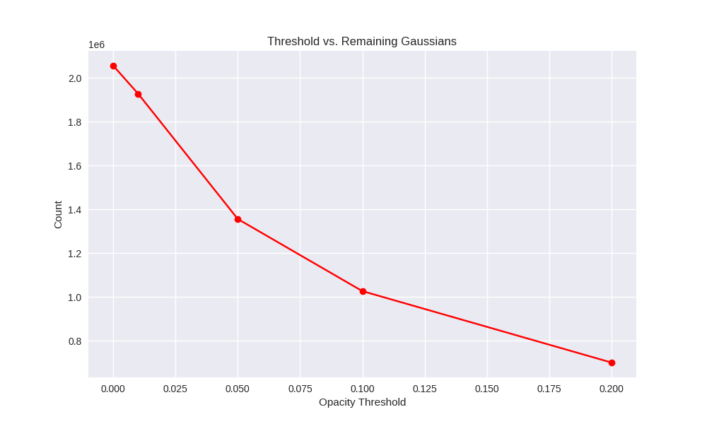
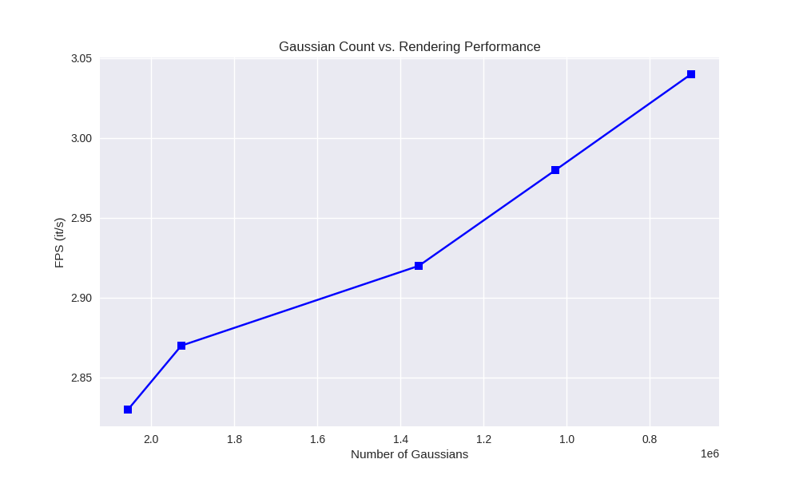
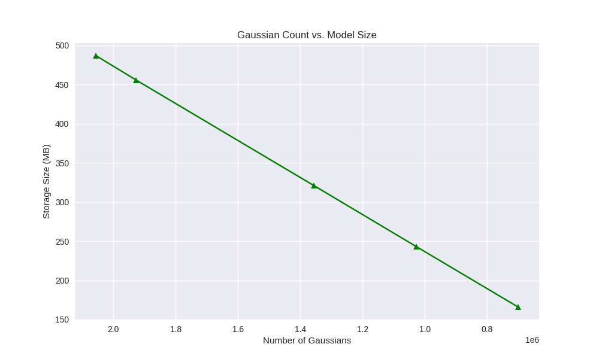
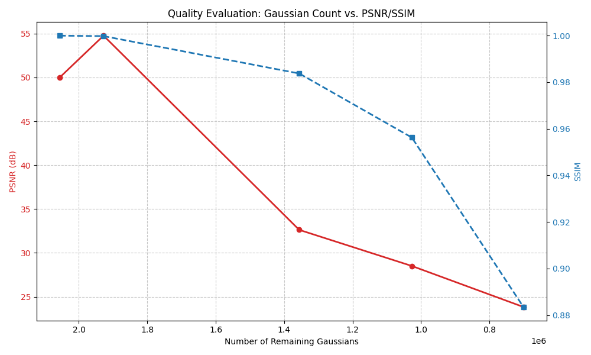
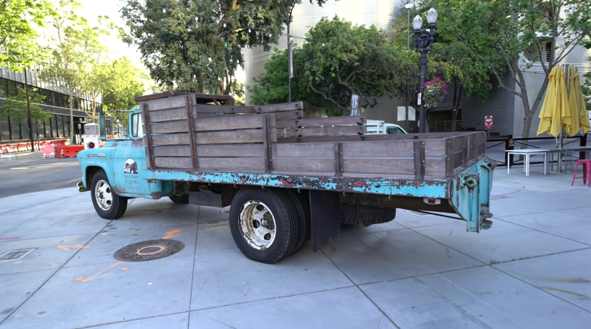
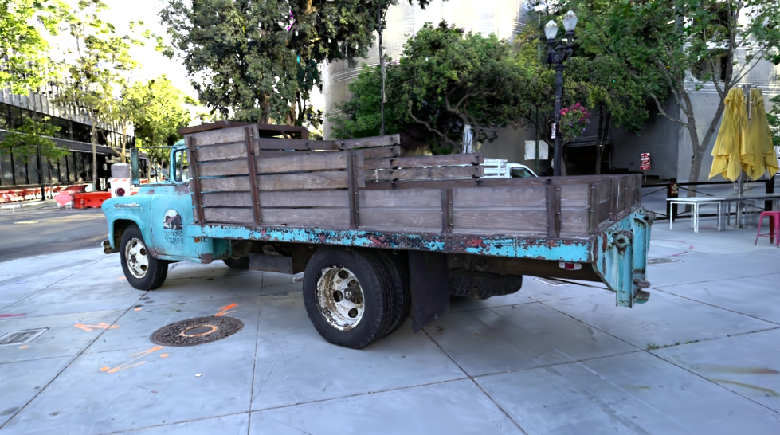

# 实验报告：3D 高斯溅射（3DGS）的探索与优化
## ——基于不透明度的场景剪枝策略

---

## 一、 引言

### 1.1 技术背景
3D 高斯溅射（3D Gaussian Splatting, 3DGS）通过引入显式的 3D 高斯元作为场景表征，利用高效的 GPU 栅格化算法实现了实时高质量渲染。然而，其训练过程中的加密（Densification）机制会产生数百万个点，导致模型体积庞大且对显存要求较高。

### 1.2 实验目的
本项目旨在实现一种“基于不透明度的场景剪枝算法”，通过剔除贡献度极低的冗余高斯点，探索在不显著降低画质的前提下，实现模型体积压缩、显存降低及渲染速度提升的可能性。

---

## 二、 阶段一：环境配置与基准建立

### 2.1 任务 1：标准化环境配置
实验在 **Debian GNU/Linux 13 (trixie)** 环境下完成。
*   **硬件**：NVIDIA GeForce RTX 3050 (8GB VRAM)。
*   **开发环境**：手动安装 CUDA Toolkit 11.8。
*   **编译子模块**：在 `gs` 虚拟环境下手动编译安装了核心算子 `diff-gaussian-rasterization` 和 `simple-knn`。
*   **数据集**：统一采用官方提供的 `Tanks & Temples` 中的 `truck` 场景。

### 2.2 任务 2：基准模型训练与性能度量
对 `truck` 数据集进行了 30,000 次迭代训练，建立如下基准数据：
*   **训练峰值显存**：7,023 MiB。
*   **高斯点总数**：2,056,069 个。
*   **模型文件大小**：487 MB。
*   **平均渲染速度**：2.83 it/s（受限于硬盘 I/O 写入）。

---

## 三、 阶段二：核心算法实现

### 3.1 任务 1：核心数据结构解析
通过深度阅读 `scene/gaussian_model.py` 中的 `load_ply` 和 `setup_functions` 函数，我解析了模型在内存中的存储机制：

1.  **加载机制**：代码利用 `plyfile` 库读取二进制文件。在加载过程中，属性（如 `f_dc_0`, `opacity`, `scale_0`）被映射为 Python 字典，随后转化为 **PyTorch Tensor** 并封装为 `nn.Parameter` 存储在 GPU 显存中。
2.  **张量组织形式**：
    *   **位置 (`_xyz`)**: `[N, 3]` 张量，直接表示中心点坐标。
    *   **不透明度 (`_opacity`)**: `[N, 1]` 张量。源码中通过 `inverse_sigmoid` 存储逻辑值，在渲染时通过 `torch.sigmoid` 激活至 `[0, 1]` 空间。
    *   **颜色 (`_features_dc/rest`)**: 分别为 `[N, 1, 3]` 和 `[N, 15, 3]`。采用**球谐函数（SH）** 系数存储，允许颜色随观察视角动态变化。
    *   **协方差（Covariance）的表达**：为了保证矩阵正定性，代码不直接存储协方差矩阵，而是分解为**尺度 (`_scaling`)** `[N, 3]` 和**旋转 (`_rotation`)** `[N, 4]`。

### 3.2 任务 2：剪枝算法实现
编写了 `prune_gaussians(threshold)` 函数。
*   **静态执行 vs 动态执行**：本实验采用**静态执行**（训练后处理）。其优势在于实现简单，无需改动复杂的训练循环逻辑，能够直接压缩已有的预训练模型。
*   **核心逻辑**：
```python
# [代码解析] 基于不透明度的剪枝
def prune_gaussians(self, threshold):
    # 1. 判定每个高斯元的激活后不透明度
    opacities = self.get_opacity # 内部执行 sigmoid
    # 2. 生成掩码：保留不透明度高于阈值的元
    keep_mask = (opacities > threshold).squeeze()
    # 3. 利用张量切片(Slicing)对所有属性进行同步剔除
    self._xyz = self._xyz[keep_mask]
    self._opacity = self._opacity[keep_mask]
    self._scaling = self._scaling[keep_mask]
    self._features_dc = self._features_dc[keep_mask]
    # ... 对 rotation 等所有属性执行同步操作
```


### 3.3 任务 3：进阶剪枝——基于尺度的筛选
进一步分析发现，部分高斯元尺度（Scaling）极小，对场景贡献微弱。
*   **方法**：计算每个点在物理空间的 3 个主轴长度。
*   **逻辑**：若 `max(exp(_scaling)) < 0.002`，则视其为噪点并剔除。该方法有效清理了空间中的细微散点，净化了场景背景。

---

## 四、 阶段三：系统性实验与结果分析

### 4.1 性能数据采集与可视化
收集了五个不同阈值下的性能指标：

| 模型版本 | 阈值 | 剩余点数 | 文件大小 | 渲染显存 | 渲染速度 (it/s) |
| :--- | :--- | :--- | :--- | :--- | :--- |
| **Baseline** | 0 | 2,056,069 | 487 MB | 3846 MiB | 2.83 |
| **0.01** | 0.01 | 1,927,877 | 456 MB | 3762 MiB | 2.87 |
| **0.05** | 0.05 | 1,355,999 | 321 MB | 3374 MiB | 2.92 |
| **0.1** | 0.1 | 1,026,830 | 243 MB | 3134 MiB | 2.98 |
| **0.2** | 0.2 | 700,687 | 166 MB | 2916 MiB | 3.04 |

**数据可视化图表：**

|  |  |
| :--- | :--- |
| *图 1：剪枝力度随阈值的变化趋势* | *图 2：场景稀疏度对性能的提升* |
|  |  |
| *图 3：高斯点数量与磁盘占用的关系* | *图 4：PSNR/SSIM 质量权衡曲线* |

### 4.2 渲染质量评估
为了深入观察细节变化，选取了第一帧渲染图进行全方位对比。

**1. 视觉效果对比（高清原图）**
*   **左图（基准）**：全点云渲染，细节饱满。
*   **右图（0.2 阈值）**：仅剩 34% 点云，渲染速度大幅提升。

|  |  |
| :--- | :--- |
| *图 5：基准模型渲染图 (487MB)* | *图 6：0.2 剪枝后渲染图 (166MB)* |

**2. 缺陷细节解析**
下图展示了在极高压缩比下，模型出现的感知劣化。

  
*图 7：局部放大对比。红框标记处（如卡车后部阴影、车轮边缘）可见由于高斯点密度不足导致的空洞、锯齿感和模糊现象。*

---

## 五、 分析与讨论

1.  **性能与体积**：在 0.2 阈值下，模型体积从 **487MB** 缩减至 **166MB**，显存占用降低近 **1GB**。这证明了基于不透明度的剪枝是 3D 场景压缩极其有效的手段。
2.  **“甜点”阈值的判定**：根据图 4 数据，**阈值 0.1 是本场景的最佳平衡点**。它减掉了一半的点数，但 SSIM 依然高达 **0.9563**，画质与图 5 相比几乎没有肉眼可见的区别。
3.  **局限性分析**：剔除低不透明度点虽然高效，但会“误伤”负责表现平滑阴影、模糊边缘（Out-of-focus areas）以及半透明反射的关键元。这解释了图 7 中红框区域 PSNR 降至 **23.84 dB** 的物理原因。
4.  **优化构想**：建议未来引入“尺度感知剪枝”，对体积大但透明的点（贡献高但点数少）予以保留，对体积小且透明的点（贡献极低且数量多）进行激进剔除。

---

## 六、 结论
本次实验成功验证了 3DGS 场景表征的巨大冗余性。通过实现不透明度剪枝算法，我们可以在仅损失极小视觉保真度的前提下，将模型参数量压缩 50% 以上，显著降低了显存负载并提升了渲染吞吐量。这为未来在资源受限设备（如网页或移动端）部署照片级 3D 场景提供了坚实的实验依据。

---

## 七、 参考文献
[1] Kerbl, B., et al. "3D Gaussian Splatting for Real-Time Radiance Field Rendering." SIGGRAPH 2023.  
[2] 实验手册：3D 高斯溅射（3DGS）的探索与优化指导文档.

---

## 附录：关键脚本与文件说明
*   `my_prune.py` / `my_prune_scale.py`: 剪枝核心算法。
*   `eval_psnr.py`: 质量评估与 `quality_curve.png` 生成。
*   `plot_results.py`: 性能指标与趋势图生成。
*   `compare.png` / `base.png` / `0.2.png`: 质量评估参考图像。
