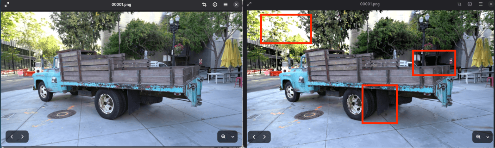

# 计算机图形学实验

一组计算机图形学课程实验，涵盖 OpenGL 交互绘制、姿态插值、光线追踪以及 3D Gaussian Splatting 场景剪枝。每个实验的代码、演示和结果放在独立目录中。

## 实验目录

| 实验 | 内容 | 代码 | 演示 |
| --- | --- | --- | --- |
| Lab 1 | OBJ 模型加载、光照与鼠标交互 | [C++](Lab1/main.cpp) | [视频](Lab1/lab1.mp4) |
| Lab 2 | 平移插值与四元数球面插值 | [C++](Lab2/main.cpp) | [视频](Lab2/lab2.mp4) |
| Lab 3 | CPU 光线追踪与 OpenGL 像素显示 | [C++](Lab3/main.cpp) | [视频](Lab3/lab3.mp4) |
| Lab 4 | 3DGS 高斯元剪枝与质量评估 | [实验说明](Lab4/README.md) | [报告](Lab4/report.md) · [视频](Lab4/lab4.mp4) |



## 运行 Lab 1–3

需要支持 C++17 的编译器、CMake 3.18+、OpenGL/GLU、FreeGLUT 和 GLM 开发文件。安装好依赖后，在仓库根目录执行：

```bash
cmake -S . -B build
cmake --build build --config Release
```

构建会生成 `lab1`、`lab2`、`lab3` 三个可执行文件。具体位置取决于 CMake 生成器，通常在 `build/` 或 `build/Release/`。

- **Lab 1**：默认显示 FreeGLUT 内置茶壶；也可在启动时将 OBJ 模型路径作为第一个参数传入。鼠标左键旋转、右键平移、滚轮缩放。
- **Lab 2**：按 `1` 查看仅平移，按 `2` 查看平移与旋转；空格开始动画，`R` 重置。
- **Lab 3**：`w/a/s/d` 移动相机，`i/j/k/l` 移动光源。

## 运行 Lab 4

Lab 4 使用 [3D Gaussian Splatting 官方实现](https://github.com/graphdeco-inria/gaussian-splatting) 的模块与 CUDA 扩展，还需要数据集和训练得到的模型。仓库只收录本实验使用的脚本、报告与结果图；安装和复现实验步骤见 [Lab 4 说明](Lab4/README.md)。无法仅凭本仓库运行该实验。

## 文件与许可

生成的构建文件、训练输出、点云模型和数据集已被 Git 忽略；演示视频和报告图表保留在对应实验目录。Lab 4 中保留了官方脚本的版权声明，其复用部分遵循 [原项目许可](Lab4/LICENSE-3DGS.md)。本仓库没有为其余代码声明统一的开源许可证。
